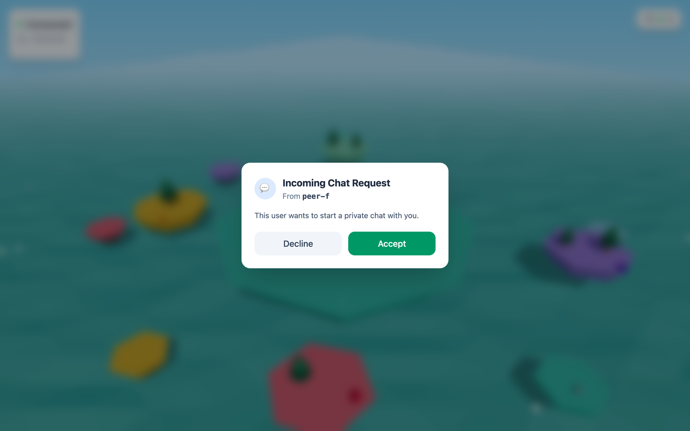
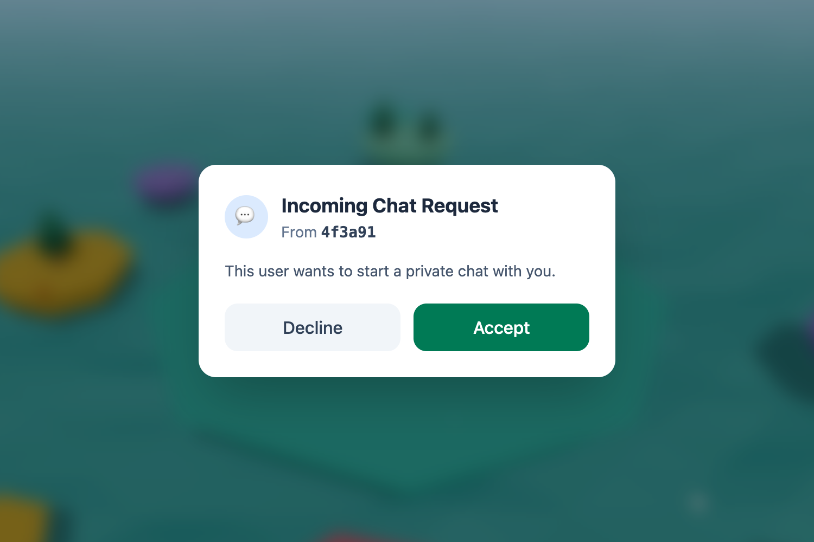
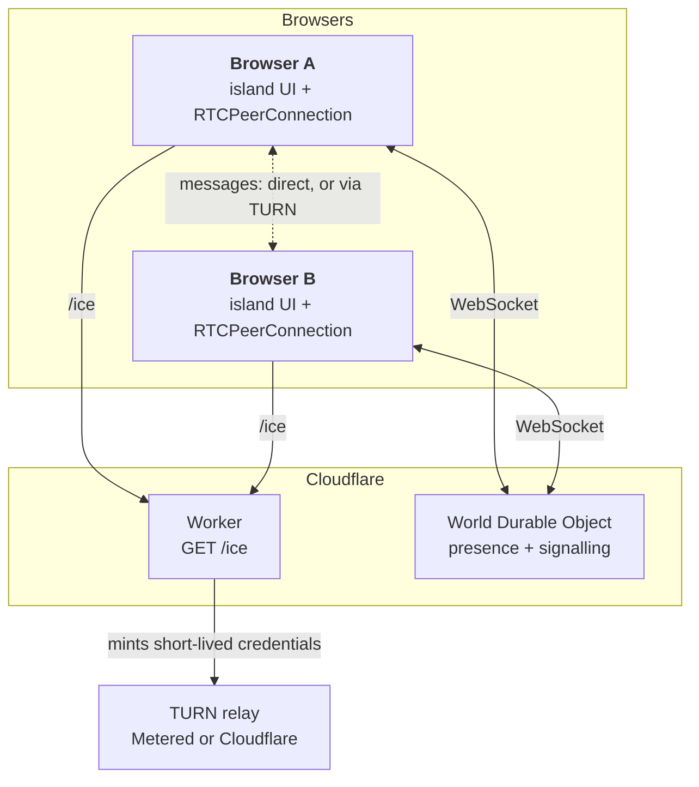
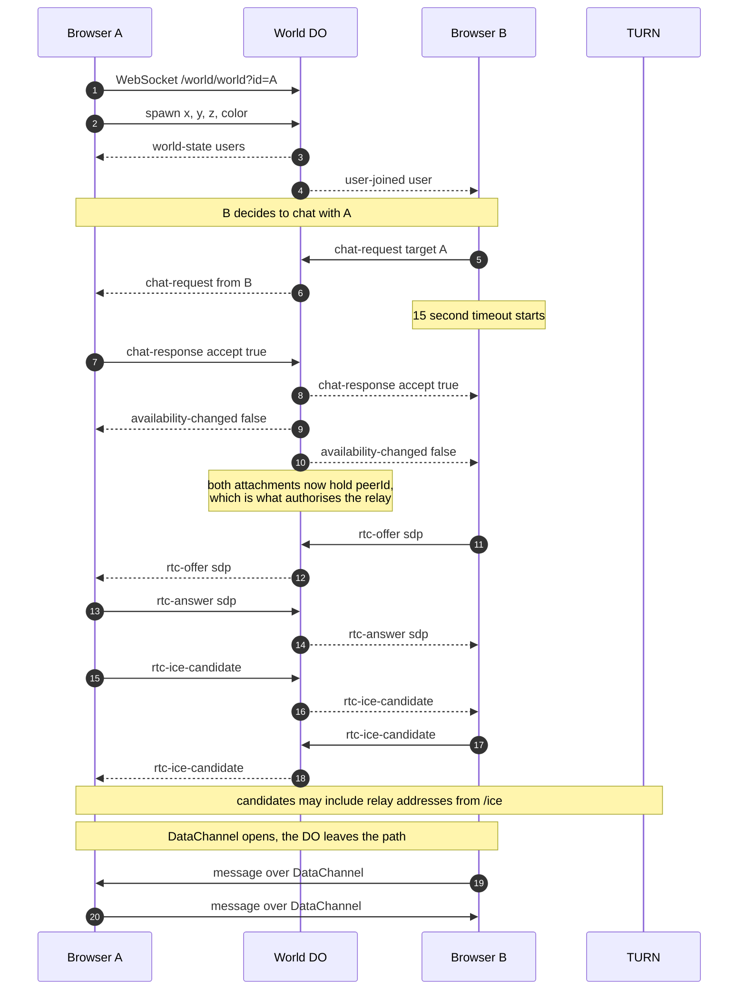

# Island Chat

**A personal project, built to learn Cloudflare Workers by doing the thing they are least obviously for:** a live 3D world where two strangers can open a private chat that never passes through your server.

[](/readme_assets/world.png)

Two browsers, one Durable Object, and a WebRTC DataChannel. The server signs people in, introduces them, and relays the handshake — then gets out of the way. Messages travel browser to browser, so the Worker that connected you cannot read them.

It is deliberately small: a text chat, no accounts, no history, no database. Everything interesting is in the seam between the two halves.

---

## What it does

One loop, no menus:

- **Join the island.** You appear as a sphere on a floating island with a colour and an ID. Orbit the scene; see who else is here.
- **Click someone.** A dialog asks whether to invite them. If they are already in a chat you are told immediately — their avatar carries a red dot instead of a green one.
- **They accept.** Both browsers negotiate a DataChannel through the Durable Object, then talk directly. The header reads `P2P Connected` only once the channel is actually open.
- **Either side leaves.** The pairing is released server-side, both users become available again, and the peer is told rather than left staring at a dead channel.

A world bot explains the one interaction, and three sound effects mark arrivals, invitations and messages.

---

## Screenshots

Every image here is the real app, captured from a running instance — no mockups.

| [](/readme_assets/world.png) **The world.** Connection state and your short ID top-left, connected-user count top-right, avatars floating over the central island. | [](/readme_assets/invite-request.png) **An invitation.** A modal over the blurred island; the sender waits with a 15-second timeout. |
|---|---|

---

## Contents

1. [What a user sees](#what-a-user-sees)
2. [Architecture](#architecture)
3. [Request lifecycle](#request-lifecycle)
4. [The protocol](#the-protocol)
5. [Design decisions that carry weight](#design-decisions-that-carry-weight)
6. [NAT, ICE and TURN](#nat-ice-and-turn)
7. [Repository layout](#repository-layout)
8. [The client](#the-client)
9. [The Worker and its Durable Objects](#the-worker-and-its-durable-objects)
10. [Cost model](#cost-model)
11. [Setup from zero](#setup-from-zero)
12. [Configuration reference](#configuration-reference)
13. [Verifying a deployment](#verifying-a-deployment)
14. [Troubleshooting](#troubleshooting)
15. [Known limits](#known-limits)
16. [Licence](#licence)

---

## What a user sees

| State | What is on screen |
|---|---|
| Not connected | A card: title, `Disconnected`, one **Enter World** button |
| Connected | The 3D world, `Connected` + short ID top-left, user count top-right, bot hint bottom-right |
| Available peer | Green ring under the avatar, pulsing |
| Busy peer | Grey ring, red status dot — clicking does nothing |
| Invitation sent | *Waiting for …* with Cancel, 15-second timeout |
| Invitation received | Modal over a blurred island: Decline / Accept |
| Timed out | *User did not respond*; the invitation is withdrawn so the other dialog closes |
| Declined | *User declined your invitation* |
| In a chat | Full-screen 2D chat: connection badge, messages, composer |
| Peer disconnected | Back to the world with *Your chat partner disconnected* |

`Connecting…` is the honest state: the SDP handshake is in flight, or ICE has not yet found a path. The badge only becomes `P2P Connected` when the DataChannel opened, which is the only signal that means anything.

---

## Architecture



Three parts, one job each:

**The Worker** is a stateless edge function. It routes `/world/*` to a Durable Object and answers `GET /ice` with the ICE configuration the browser should use. It holds the TURN secret, so credentials are minted server-side and never appear in the client bundle.

**The World Durable Object** is the only stateful thing. A single globally-addressed instance holds every socket in the world, each user's presence, and who is paired with whom. It is also the signalling relay — the SDP offer, answer and ICE candidates pass through it, because two browsers that cannot address each other certainly cannot address each other's handshake.

**The browsers** do the work. Once the DataChannel is open the Durable Object is not in the path: `dc.send()` goes peer to peer and the server sees nothing.

Two consequences of this shape, both deliberate:

- **The DO is a switchboard, not a message bus.** It relays signalling and never chat. If the DataChannel fails, the chat fails — there is no fallback that quietly routes your messages through the server (see [known limits](#known-limits)).
- **The client never holds a TURN key.** A TURN key mints unlimited credentials, and anything in a Vite bundle is public. So the browser asks, the Worker mints, and the bundle contains a URL and nothing else.

---

## Request lifecycle



### The flow, in words

1. **You press Enter World.** The client generates a UUID once per page load and opens a WebSocket to `/world/world?id=<uuid>`. The Worker hashes that id to pick a Durable Object, so everyone in the same world lands in the same instance.
2. **The socket is accepted, then announced.** The DO stores a per-socket attachment (id, position, colour, `available: false`, `spawned: false`) and accepts it with `ctx.acceptWebSocket()`. The user is not counted as present until the client sends `spawn` — which is what makes this hibernation-safe: state lives in the attachment, not in a variable the runtime may evict.
3. **Spawn returns the world.** The newcomer receives `world-state` (everyone already here) and everyone else receives `user-joined`.
4. **An invitation is checked against server state, not client claims.** The target must exist, be spawned, and not already be paired. If they are busy you get a decline immediately rather than waiting out the timeout.
5. **Acceptance pairs the two sockets.** The DO writes `peerId` into both attachments. That is the authorisation boundary for everything after: signalling is relayed only when `attachment.peerId === target`, so an uninvited third party cannot push an offer at you.
6. **The offerer negotiates.** The inviter creates the DataChannel, produces an offer, and relays it; candidates flow both ways as they are gathered.
7. **ICE finds a path, or the relay does.** Candidates include local addresses, server-reflexive addresses learned from STUN, and relay addresses from TURN. If a direct pair works, the relay is never used. Behind symmetric NAT — most mobile carriers — only the relay pair works, which is why `/ice` exists.
8. **The channel opens and the server is done.** `dc.onopen` flips the badge. From here messages are `dc.send()`: peer to peer, unlogged.
9. **Leaving releases the pair.** `chat-leave` clears `peerId` on both sides, tells the peer `peer-left`, and both become available again. Losing the socket does the same server-side.

---

## The protocol

Every message is a discriminated union member of `ClientMessage` or `ServerMessage` in [`packages/types`](packages/types/src/index.ts) — one definition imported by the Worker and the browser, so a typo is a compile error on whichever side is wrong.

**Client → server**

| Message | Payload | Purpose |
|---|---|---|
| `spawn` | `x, y, z, color, available` | Announce presence; triggers `world-state` |
| `set-available` | `available` | Opt in or out of invitations (rejected while paired) |
| `chat-request` | `target` | Invite a user |
| `chat-response` | `target, accept, roomId` | Answer an invitation |
| `chat-cancel` | `target` | Withdraw a pending invitation (cancel or timeout) |
| `chat-leave` | — | Release the pairing |
| `rtc-offer`, `rtc-answer` | `target, payload` | SDP |
| `rtc-ice-candidate` | `target, payload` | ICE |

**Server → client**

| Message | Purpose |
|---|---|
| `world-state`, `user-joined`, `user-left` | Presence |
| `availability-changed` | Someone entered or left a chat |
| `chat-request`, `chat-response`, `chat-cancelled` | Invitation flow |
| `rtc-offer`, `rtc-answer`, `rtc-ice-candidate` | Relayed signalling |
| `peer-left` | Your chat partner disconnected |
| `error` | `busy`, `not-found`, `bad-message`, `too-large`, `not-paired`, `already-paired` |

The `error` type exists because of a specific lesson: the first version broadcast any unrecognised message type to the whole world, which turned the Durable Object into an open fan-out relay any client could spam. Unknown types are now rejected.

---

## Design decisions that carry weight

Each of these is a bug that was found, understood and closed. This is the part of the project worth reading.

**Presence lives in the socket attachment.** A Durable Object can be evicted between messages, and a module-level `Map` would silently lose every user on the island. `ws.serializeAttachment()` survives hibernation, so the world is reconstructed from the sockets themselves.

**Signalling is authorised against server state.** The DO pairs two users on acceptance and relays only between that pair. Without it, anyone who reads the bundle can find the relay and push an SDP offer at a stranger.

**A reconnect can race the old socket's close.** Each page load mints a new UUID, but a reconnect within a session reuses the id. If the old socket is still half-open, the world ends up with two sockets claiming one id: a duplicate avatar, and messages routed to the dead one. On `spawn`, any other socket with that id is closed with code `4001` — and the client treats `4001` as "another tab won", not as a reason to reconnect.

**ICE candidates are queued, not dropped.** `addIceCandidate` throws when there is no remote description yet, and candidates are gathered as soon as the local description is set — so they routinely arrive before the offer or answer. Dropping them is the classic cause of "connects for me, fails for you". They are buffered, and flushed after `setRemoteDescription`.

**Invitations expire on both ends.** The sender times out after 15 seconds and sends `chat-cancel`, so the other side's dialog closes instead of sitting there for an invitation that no longer exists.

**The client degrades rather than fails.** If `/ice` is unreachable, `lib/ice.ts` uses public STUN and chat still works on permissive networks. A broken configuration endpoint should reduce connectivity, not remove it.

---

## NAT, ICE and TURN

Worth spelling out, because this is the part of WebRTC people usually get wrong.

Both browsers are behind NAT: you hold a private address, your router rewrites outbound packets to a public one, and you do not know which public port it picked.

- **ICE** is the algorithm that tries to solve this. Each side gathers candidate addresses and sends them to the other through the signalling channel (our Durable Object); both then attempt every pair. The first pair that works carries the traffic.
- **STUN** tells you your own public address — "I see you as 203.0.113.7:54321" — which becomes a *server-reflexive* candidate. It is free, stateless, and useless when the router hands out a different port per destination.
- **TURN** gives up on directness. The client authenticates, gets an allocation, and both sides send through the relay. It always works and it costs bandwidth: Cloudflare charges **$0.05/GB** outbound, and Metered's free tier is a few hundred megabytes.
- **Symmetric NAT** is why the relay is not optional. When the router allocates a per-destination port, nothing you advertise is reachable, so hole punching cannot succeed. Most mobile carriers behave this way — which is exactly why an app that is perfect on your Wi-Fi can fail completely on a phone.

The relay credentials are minted by the Worker and never shipped:

```
browser ──GET /ice──▶ Worker ──POST credential?secretKey=…──▶ Metered
        ◀──{iceServers:[{urls, username, credential}]}──
```

`/ice` is also the only endpoint that spends money, so it is guarded: an `Origin` allowlist (403 otherwise) in front of a **per-IP rate limit held in a Durable Object** — a counter in the Worker would live in a single isolate, and an attacker hitting different Cloudflare locations would get a fresh allowance in each.

---

## Repository layout

```
p2p-chat-app-cloudflare-workers/
├── apps/
│   ├── client/                      React 19 + Vite + React Three Fiber
│   │   ├── public/
│   │   │   ├── _headers             CSP, frame protection, asset caching
│   │   │   └── sounds/              join, invitation, message
│   │   └── src/
│   │       ├── App.tsx              the whole client state machine
│   │       ├── components/
│   │       │   ├── IslandWorld.tsx  the 3D scene: ocean, islands, avatars
│   │       │   ├── PrivateChat.tsx  2D chat view
│   │       │   ├── InvitationModal.tsx
│   │       │   └── WorldBot.tsx
│   │       └── lib/
│   │           ├── ice.ts           fetches /ice, caches until expiry
│   │           ├── constants.ts
│   │           └── utils.ts
│   └── server/                      Cloudflare Worker
│       ├── src/
│       │   ├── index.ts             router, /ice, CORS, provider selection
│       │   ├── world.ts             the World Durable Object
│       │   └── rate-limiter.ts      the IceRateLimiter Durable Object
│       ├── scripts/smoke.mjs        22 protocol checks against a live DO
│       └── wrangler.toml            bindings, migrations, documented vars
├── packages/types/src/index.ts      the wire protocol, shared by both ends
├── infra/turn/                      coturn in Docker, for local TURN testing
└── .github/                         CI, PR template, Dependabot
```

`packages/types` is imported as **source** — no build step, no `dist`. TypeScript, Vite and the wrangler/esbuild bundler all consume `.ts` from a linked workspace package, and it is the only way to keep one definition instead of three copies drifting apart.

---

## The client

`App.tsx` is one component and one state machine. The refs it keeps are deliberate:

| Ref | Why it exists |
|---|---|
| `wsRef` | The socket, across renders |
| `pcRef` / `dcRef` | The peer connection and its channel |
| `pendingCandidatesRef` | Candidates that arrived before the remote description |
| `shouldReconnectRef` / `attemptRef` | Backoff, and the difference between a drop and an unmount |

Identity (id, colour, position) is generated once with `useState(() => …)` rather than read from a ref during render — React 19's lint rules are right about this, and it keeps the values stable in StrictMode.

Reconnects use exponential backoff capped at 8 seconds, and the socket is closed on unmount. The client does **not** reconnect after a `4001` close, because that code means another tab took over the identity and reconnecting would start a fight.

`lib/ice.ts` caches the ICE configuration until a minute before its TTL, deduplicates concurrent requests, and falls back to public STUN on any failure.

The 3D scene is cheap on purpose: one instanced mesh for the particles, flat shading everywhere, and per-vertex wave animation on a single 80×80 ocean plane. It still ships a 1.2 MB bundle, because three.js is three.js.

---

## The Worker and its Durable Objects

| Binding | Class | Purpose |
|---|---|---|
| `WORLD` | `World` | Presence, invitations, signalling relay |
| `RATE_LIMITER` | `IceRateLimiter` | Sliding-window counter, one instance per client IP |

Both are SQLite-backed Durable Objects, which is what makes them available on the Workers free plan.

`World` implements the hibernation API (`webSocketMessage`, `webSocketClose`, `webSocketError`) rather than raw listeners, so Cloudflare can evict the object between messages without dropping users.

Three HTTP routes:

| Route | What it does |
|---|---|
| `GET /ice` | Origin-checked, rate-limited ICE configuration |
| `GET /health` | Readiness probe, used by CI and `wrangler dev` |
| `/world/{name}?id={uuid}` | WebSocket upgrade, routed to a DO via `idFromName` |

`/ice` resolves a provider in this order, falling through on any failure: **Cloudflare TURN** (key + token) → **Metered** (secret key, two-step credential mint) → **static credentials** (local coturn) → **public STUN**. Credentials are cached per isolate until a minute before expiry, so ordinary traffic does not mint.

---

## Cost model

The whole thing is designed to run without a card on file.

| Piece | Plan | What it costs |
|---|---|---|
| Cloudflare Workers | Free | Requests included; this app makes a handful per session |
| Durable Objects (SQLite-backed) | Workers Free | Included; storage is a WebSocket attachment per user |
| Cloudflare Pages | Free | Static hosting for the client |
| Metered TURN | Free trial | **500 MB** in the dashboard I started with — the marketing page claims more; the account is what counts |
| Cloudflare TURN | Paid | **$0.05/GB** outbound, billing enabled required |

TURN is the only line that can grow, and only for users who cannot connect directly. Messages are bytes: 500 MB is an enormous number of them. `/ice` is rate limited precisely because it is the one endpoint that spends money.

---

## Setup from zero

Requirements: Node 20+, pnpm 10+, and Docker only if you want to test TURN locally.

```bash
git clone https://github.com/kusalkalinga00/p2p-chat-app-cloudflare-workers.git
cd p2p-chat-app-cloudflare-workers
pnpm install
pnpm dev          # Vite on :5173, wrangler on :8787
```

Open http://localhost:5173 and press **Enter World**. Two browser windows will see each other; on one machine the connection is direct and needs no TURN.

> **Wrangler is a workspace dependency, not a global install.** Use `pnpm --filter server exec wrangler <command>`. Do not `npm i -g wrangler` — the pinned version is the one `wrangler.toml` was written against.

> **Port 5173 may be busy.** If another project holds it, run `pnpm --filter client dev -- --port 5180`, and add that origin to `ALLOWED_ORIGINS` if you want `/ice` to answer.

Deploy the Worker:

```bash
cd apps/server
pnpm exec wrangler login
pnpm exec wrangler deploy
```

The client deploys from git: Pages is connected to `main`, so merging is the deploy. Otherwise:

```bash
pnpm --filter client build
pnpm exec wrangler pages deploy apps/client/dist
```

---

## Configuration reference

**Client** — `apps/client/.env.local`, or the Pages build environment

| Variable | Default | Notes |
|---|---|---|
| `VITE_WORLD_WSS_URL` | `http://localhost:8787` | Worker origin. The browser upgrades `http(s)` to `ws(s)`. |

**Worker** — `[vars]` in `wrangler.toml`, or `wrangler secret put`

| Variable | Secret | Default | Notes |
|---|---|---|---|
| `ALLOWED_ORIGINS` | no | localhost + the Pages domain | CORS **and** the `/ice` allowlist |
| `ICE_RATE_LIMIT` | no | `30` | Requests per IP per window |
| `ICE_RATE_WINDOW_SECONDS` | no | `3600` | Window length |
| `METERED_SECRET_KEY` | **yes** | — | Developers page in the Metered dashboard |
| `METERED_APP` | yes | — | `island-chat`, or `island-chat.metered.live` |
| `TURN_KEY_ID`, `TURN_KEY_API_TOKEN` | **yes** | — | Cloudflare TURN alternative |
| `TURN_URLS`, `TURN_USERNAME`, `TURN_PASSWORD` | **yes** | — | Static credentials, e.g. local coturn |

Secrets apply immediately without a redeploy; `[vars]` need one. `wrangler secret put` prompts without echoing — if the paste appears to do nothing, it worked.

---

## Verifying a deployment

Three rungs, cheapest first.

**1. The ICE endpoint, with an Origin header** (`curl` without one is meant to fail):

```bash
curl -s -H "Origin: https://p2p-chat-app-cloudflare-workers.pages.dev" \
  https://p2p-chat-server.kusalkalingainfo.workers.dev/ice
```

A working configuration returns `turn:` and `turns:` URLs with a `username` and `credential`. Seeing only `stun.l.google.com` means no provider is configured and clients are falling back.

**2. The protocol, against the live Durable Object:**

```bash
WORLD_URL=wss://p2p-chat-server.kusalkalingainfo.workers.dev \
  node apps/server/scripts/smoke.mjs
```

22 checks: presence, the invitation handshake, relay authorisation, unknown-message rejection, pairing release, and the reconnect/ghost-socket path. Locally, `pnpm --filter server smoke` against `pnpm --filter server dev`.

**3. Two devices, one on mobile data.** The only test that exercises the relay. Wi-Fi to Wi-Fi connects with or without TURN and proves nothing: laptop on Wi-Fi, phone on a carrier network, invite each other. It should connect, and it should be measurably slower than the direct case.

---

## Troubleshooting

| Symptom | Cause | Fix |
|---|---|---|
| `curl /ice` returns `403` | No `Origin` header — by design | Add `-H "Origin: <your pages domain>"` |
| `/ice` returns only Google STUN | No provider configured, or the mint failed | Check `wrangler secret list` and the Worker logs |
| `/ice` returns `429` | Rate limit spent | Wait for `Retry-After`, or raise `ICE_RATE_LIMIT` |
| Works, then stops within the first couple of minutes | Metered credentials take up to ~2 minutes to propagate | Wait and retry; the client prefetches on connect |
| Chat stuck on `Connecting…` | ICE found no working pair | Expected behind symmetric NAT without TURN; check `/ice` |
| `ERR_PNPM_IGNORED_BUILDS` on every command | pnpm 10+ blocks postinstall scripts | `allowBuilds` in `pnpm-workspace.yaml` (already set) |
| Local coturn logs `403 Forbidden IP` | coturn will not relay to its own external address | Expected on a single host; test with two networks |
| Docker: port `491xx` already in use | A previous container still holds the relay range | `docker compose down`, then retry |
| Avatar flickers between two tabs | Two tabs claiming the same user id | The newer socket wins; the older is closed with `4001` |

---

## Known limits

- **No fallback when P2P fails.** If the DataChannel cannot open, messages do not flow; there is no server-side relay for chat content. That is a deliberate property — the server cannot read your messages because it never has them — but it means a hostile network needs TURN, not a cleverer client.
- **Relay-to-relay is unverified locally.** With coturn in Docker and both peers on one machine, the only available peer address is the TURN server's own, which coturn refuses as loop protection. Allocation is verified; a full media path through the relay needs two networks.
- **Positions are cosmetic.** The server stores `x/y/z`, but avatars are laid out on a ring by index. No movement, no collision, no persistence.
- **No accounts.** Identity is a UUID in memory: a reload is a new user, and anyone can claim any world name.
- **No history.** Messages live only in the two browsers and vanish when either leaves.
- **One Durable Object per world.** Fine for dozens of users; a single DO is a single point of serialisation and would not hold a crowd.
- **No unit tests.** The protocol has 22 integration checks against a real DO; the React client has none.

---

## Licence

[MIT](LICENSE) © 2026 kusalkalinga00.

Use it, fork it, ship it. Attribution is the only requirement.
